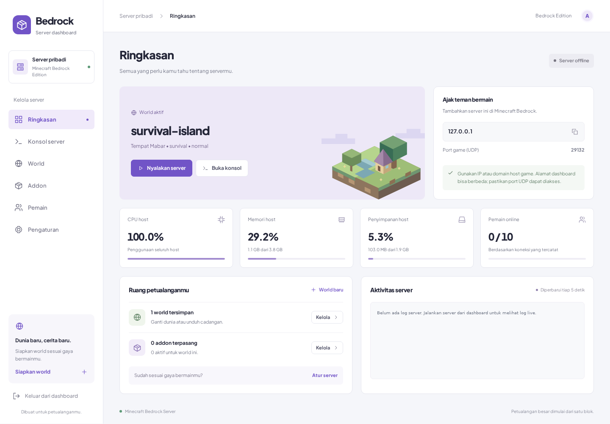

# Minecraft Bedrock Server Dashboard



## Setup

Requires Node.js >=22.12.0. Extract the official Linux Bedrock Server 1.26.52.3 archive into `bedrock-server/` in the project root and make `bedrock_server` executable. Keep world data and configuration in that directory.

Create `.env` from `.env.example` and set the administrator credentials, then run:

```sh
npm ci
npm install -g pm2
npm run build
pm2 start ecosystem.config.cjs
pm2 save
```

The dashboard listens on `http://<server-ip>:4321`. Bedrock starts automatically with the dashboard. Set `BEDROCK_AUTOSTART=false` in `.env` to start it manually instead. Log in using the credentials in `.env` to manage it. Bedrock runs as a child of the dashboard so its console and controls remain available. Keep PM2 at one instance because sessions and server state are held in memory.

Bedrock 1.26.52.3 enables its allowlist by default. Add players through the dashboard console:

```text
allowlist add "Gamertag"
```

## Operations

```sh
pm2 status
pm2 logs bedrock-dashboard
```

After changing the web code, stop Bedrock gracefully from the dashboard, then run:

```sh
npm run build
pm2 restart ecosystem.config.cjs --update-env
pm2 save
```

Bedrock starts again automatically after the dashboard restart. `pm2 save` stores the process list; automatic startup after a machine reboot requires separately installing the service with `pm2 startup` and following its output.

## NetherNet networking

Use **Pengaturan → Akses dan koneksi** to edit the native `server.properties` variables. Restart Bedrock to apply them.

| Variable           | Value / purpose                                                                  |
| ------------------ | -------------------------------------------------------------------------------- |
| `transport`        | `nethernet` selects WebRTC transport; `raknet` selects the older UDP transport.  |
| `server-port`      | `19132`: TCP signaling with NetherNet.                                           |
| `server-ip`        | Empty binds all local interfaces. Use a local IP literal to select an interface. |
| `server-udp-ports` | `19140-19159` pins UDP gameplay ports. Empty uses dynamic OS ports.              |
| `server-portv6`    | Ignored with NetherNet; the TCP listener handles both IP families.               |

For a server behind NAT, advertise the actual inbound public IP and its forwarded UDP ports:

```properties
transport=nethernet
server-port=19132
server-ip=0.0.0.0
server-udp-ports=PUBLIC_IP:19140:19140,PUBLIC_IP:19141:19141,PUBLIC_IP:19142:19142,PUBLIC_IP:19143:19143,PUBLIC_IP:19144:19144,PUBLIC_IP:19145:19145,PUBLIC_IP:19146:19146,PUBLIC_IP:19147:19147,PUBLIC_IP:19148:19148,PUBLIC_IP:19149:19149,PUBLIC_IP:19150:19150,PUBLIC_IP:19151:19151,PUBLIC_IP:19152:19152,PUBLIC_IP:19153:19153,PUBLIC_IP:19154:19154,PUBLIC_IP:19155:19155
```

Replace every `PUBLIC_IP` with the address players actually reach. This configuration uses explicit per-port mappings, which resolved the connection failure on the deployed server. The public outbound address of a cloud VM is not necessarily an inbound address. Open/forward TCP **19132** and UDP **19140–19155** to this host in the router/cloud firewall (Azure NSG as applicable). The two ranges in a mapping must have equal lengths. IPv6 addresses use brackets, for example `[2001:db8::1]:19140:19140`. Multiple entries use commas. Size the UDP pool for concurrent players and connection attempts.

A `Door` connection error alone does not identify the cause. If TCP signaling responds but joining fails, check the advertised UDP IP/ports and each firewall/NAT layer. Opening only UDP 19132 does not cover NetherNet gameplay. This dashboard configures Bedrock; it does not change cloud firewall or router rules.

The bundled `bedrock-server/bedrock_server_how_to.html` documents these native variables for the installed server version. See also the [Bedrock container project's NetherNet instructions](https://github.com/itzg/docker-minecraft-bedrock-server/blob/master/README.md#nethernet).

BDS 1.26.52.3 accepts at most 16 mapping entries. An entry can contain a range. If troubleshooting NAT connectivity, try listing individual mappings (for example `PUBLIC_IP:19140:19140,PUBLIC_IP:19141:19141`) and confirm the result from an actual Minecraft client. A successful `GET /v1/join` verifies signaling availability only; it does not verify authenticated SDP negotiation or UDP gameplay.
